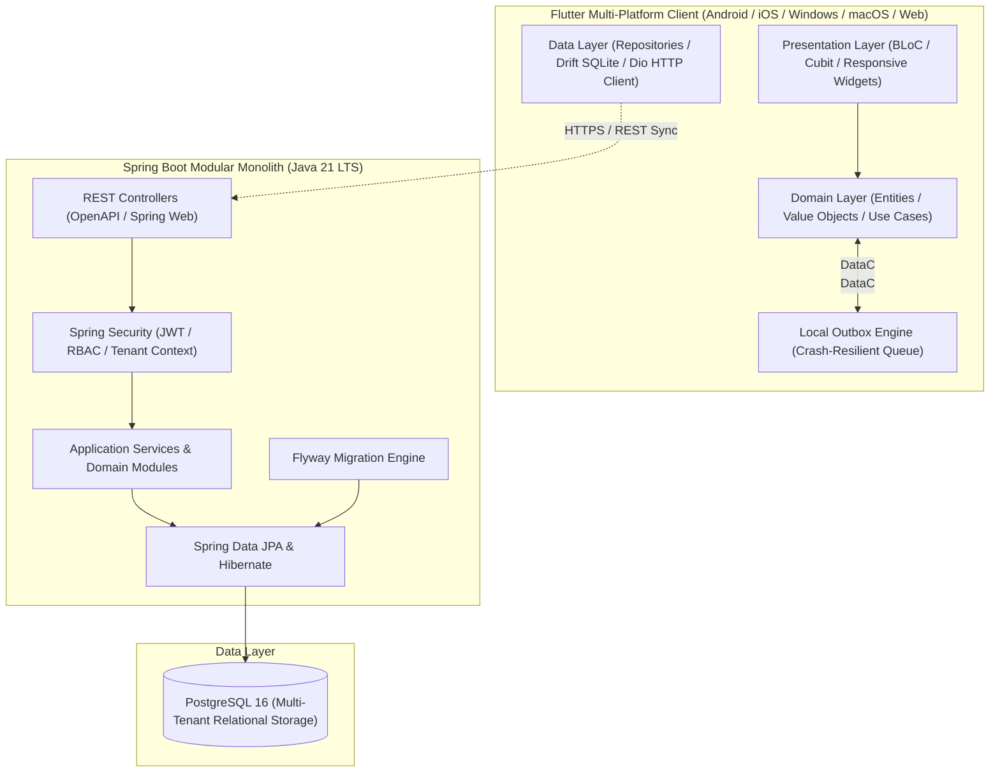

# Universal POS — Architecture Specification

## 1. Architectural Philosophy
Universal POS is designed as an **Offline-First, Modular Monolith System** with clean layer boundaries, predictable data flow, and domain isolation.

---

## 2. Frontend Architecture (Flutter)

### 2.1 Pattern: Clean Architecture + Feature-First
Dependencies flow strictly inwards:
`Presentation -> Domain <- Data`

- **Domain Layer:** Pure Dart. Zero dependencies on Flutter UI frameworks, Drift SQLite, or Dio HTTP. Contains business entities, domain exceptions, repository interfaces, and use case interactors.
- **Data Layer:** Implements repository contracts. Orchestrates local storage (`Drift`/`SQLite`) and remote API queries (`Dio`). Houses the **Offline Outbox Engine**.
- **Presentation Layer:** Built with **BLoC/Cubit** for deterministic state management, **GoRouter** for declarative deep-linking and route protection, and a unified design system.

### 2.2 Offline-First Transaction Engine
Billing operations execute against the local SQLite database.
1. Cashier checks out order.
2. Order, line items, and payment records are validated locally.
3. Order and outbox event (`SyncEvent`) are written atomically in a single local SQLite transaction.
4. UI displays immediate receipt / success state.
5. Background synchronization worker picks up un-synced outbox events, posts them to the backend with client-generated UUIDs (idempotency keys), and marks events as synchronized upon server ACK.

---

## 3. Backend Architecture (Spring Boot)

### 3.1 Architectural Style: Modular Monolith
To prevent premature operational overhead while preserving clean boundaries:
- Unified codebase organized into distinct functional domain packages (`com.universalpos.*`):
  - `identity`
  - `tenancy`
  - `organization`
  - `catalog`
  - `pricing`
  - `orders`
  - `payments`
  - `inventory`
  - `synchronization`
  - `shared`
- Cross-module communication occurs strictly through public Java interfaces and domain events; direct imports of internal repositories or entities across modules are prohibited.

### 3.2 Authoritative Responsibilities
The backend serves as the single source of truth for:
1. Multi-tenant isolation and subscription entitlement validation.
2. Financial audit logs and fiscal tax calculations.
3. Cross-branch synchronization and inventory reconciliation.
4. Cryptographic token generation and hardware device pairing.

---

## 4. Multi-Tenant Data Isolation Strategy
- Multi-tenancy is modeled with a discriminator column (`tenant_id`) enforced across all tenant-scoped business tables.
- Authentication tokens embed `tenant_id` and authorized `branch_id`s in digitally signed JWT claims.
- A servlet filter extracts and sets the tenant context into a thread-local `TenantContextHolder`.
- All database queries and JPA specifications automatically inject tenant scoping.
- Optional defense-in-depth: PostgreSQL Row-Level Security (RLS) can be enabled to enforce isolation at the database session level.
