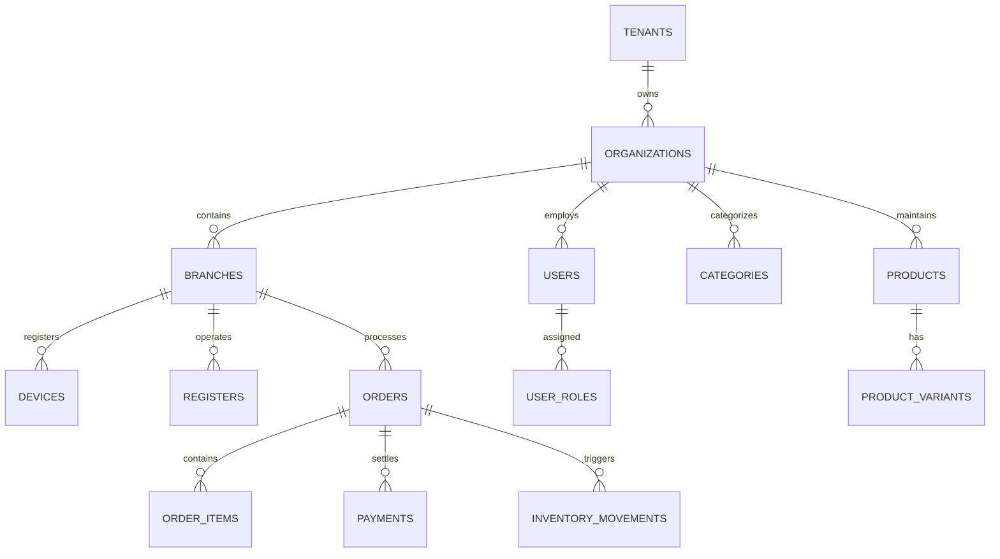

# Universal POS — Database Design Specification

## 1. Core Principles
- **Relational Integrity:** Engine is PostgreSQL 16+.
- **Identifiers:** Primary keys are UUIDv4 to enable decentralized, offline ID generation on edge POS terminals without key collision risk.
- **Monetary Precision:** All monetary amounts are stored as `NUMERIC(15, 4)` or `NUMERIC(12, 2)` to eliminate floating-point inaccuracies. Zero raw floats.
- **Currency Transparency:** Currency code (`ISO 4217`, e.g., `'INR'`) is stored explicitly alongside monetary amounts.
- **Temporal Integrity:** All timestamps are stored in UTC (`TIMESTAMPTZ`).
- **Audit Tracking:** All core tables maintain `created_at`, `updated_at`, `created_by`, and `version` (optimistic locking).
- **Immutable Ledger:** Financial transactions, payment records, stock ledger entries, and audit logs are append-only. Finalized financial entries are never updated destructively.
- **Schema Evolution:** Managed exclusively via sequential Flyway migrations (`V{version}__{description}.sql`).

---

## 2. Entity Relationship Overview (High Level)

---

## 3. Incremental Database Roadmapping
The database schema will NOT be generated in a monolithic blob. Each phase introduces only the tables required for its verified feature scope:

- **Phase 1 (Foundation):** Schema versioning baseline (`schema_version`), system heartbeat / schema verification.
- **Phase 2 (Auth & Tenancy):** `tenants`, `organizations`, `branches`, `users`, `roles`, `permissions`, `devices`, `refresh_tokens`.
- **Phase 3 (Core POS):** `categories`, `products`, `product_variants`, `barcodes`, `taxes`, `orders`, `order_items`, `registers`.
- **Phase 4 (Offline Engine):** `sync_events`, `device_sync_checkpoints`.
- **Phase 5 (Inventory):** `inventory_balances`, `inventory_movements`, `suppliers`, `purchase_orders`.
- **Phase 6 (Payments):** `payments`, `payment_transactions`, `refunds`.

---

## 4. Multi-Tenant Schema Rules
1. Every tenant-scoped table MUST include `tenant_id UUID NOT NULL REFERENCES tenants(id) ON DELETE RESTRICT`.
2. Composite indexes MUST lead with `tenant_id` where filtering by tenant occurs, e.g., `CREATE INDEX idx_products_tenant ON products(tenant_id, is_active)`.
3. Foreign key constraints must enforce cascade restrictions to prevent accidental data deletion across organizational tiers.
